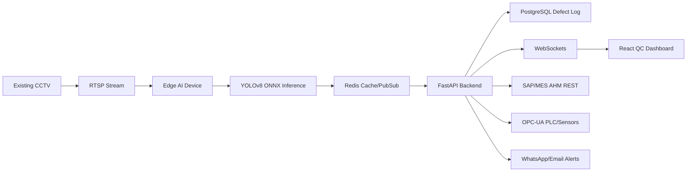

# MotionQA Technical Design

## System Architecture



## PostgreSQL Defect Log

```sql
-- AI Assisted Logic
CREATE TYPE defect_type AS ENUM ('casting_defect', 'scratch', 'dimensional_deviation', 'none');
CREATE TYPE inspection_status AS ENUM ('PASSED', 'FAILED');

CREATE TABLE components_log (
    id SERIAL PRIMARY KEY,
    component_code VARCHAR(50) NOT NULL UNIQUE,
    timestamp TIMESTAMP WITH TIME ZONE DEFAULT CURRENT_TIMESTAMP,
    defect_found defect_type DEFAULT 'none',
    confidence_score NUMERIC(4,3) NOT NULL,
    status inspection_status NOT NULL,
    image_snapshot_url TEXT,
    line_id VARCHAR(20) NOT NULL
);

CREATE INDEX idx_components_log_timestamp ON components_log(timestamp);
CREATE INDEX idx_components_log_status ON components_log(status);
CREATE INDEX idx_components_log_line_id ON components_log(line_id);
```

## Runtime Contracts

- Edge publishes `liveQcFeed` events into Redis.
- FastAPI persists inspection logs to PostgreSQL through `/api/v1/defects`.
- FastAPI streams Redis events to React through `/ws/qc-stream`.
- FastAPI exposes `/api/v1/integrations/mes` for SAP/MES synchronization.
- FastAPI exposes `/api/v1/integrations/opcua/status` for PLC status publishing.

