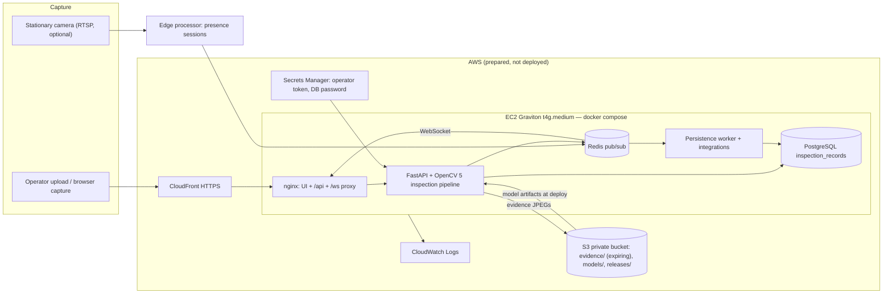

# MotionQA Architecture

Status labels used below: **Implemented** (code exists), **Tested locally** (exercised by tests or a local run),
**Prepared, not deployed** (configuration exists, AWS deployment not executed).

## System diagram

## Inspection pipeline (Implemented, Tested locally)

`backend/motionQa/inspection/inspectionPipeline.py` runs these stages for one physical inspection:

| Stage | OpenCV 5 functions | Output |
| --- | --- | --- |
| Decode and validate upload | `cv.imdecode` (with `OPENCV_IO_MAX_IMAGE_PIXELS`), magic-byte check | 4xx for invalid uploads; no record |
| Part localization | `cv.cvtColor` (Lab), `cv.GaussianBlur`, `cv.threshold` (Otsu), `cv.morphologyEx`, `cv.findContours`, `cv.convexHull`, `cv.boundingRect` | part mask, box, area fraction, border contact |
| Capture gates | `cv.Sobel` + `cv.magnitude` on the part silhouette band (focus), background median luminance and frame clipping (exposure), `cv.dilate`/`cv.erode` | `RETAKE` (blur, exposure, framing) or `NO_PART` |
| Crop and preprocessing | `cv.copyMakeBorder`, `cv.resize`, `cv.dilate`, `cv.dnn.blobFromImageWithParams` (RGB, ImageNet mean/std) | 448×448 blob, scoring mask |
| Feature extraction | `cv.dnn.readNetFromONNX(..., cv.dnn.ENGINE_NEW)`, `Net.forward` | MobileNetV2 tensors at stride 8 and 16 |
| Patch embedding | `cv.blur` (3×3 local aggregation), `cv.resize` | 56×56×128 patch features |
| Anomaly scoring | nearest-neighbour distance to a 16k-patch coreset (NumPy), `cv.resize`, `cv.GaussianBlur` | anomaly map, raw image score, identity distance |
| Decision | thresholds from the validated profile | `PASS` / `REVIEW` / `FAIL`, or `NO_PART` (part not recognized) |
| Evidence | `cv.connectedComponentsWithStats`, `cv.applyColorMap`, `cv.addWeighted`, `cv.rectangle`, `cv.putText`, `cv.imencode` | input JPEG and annotated overlay |

The feature model is derived from the OpenCV Zoo MobileNetV2 classifier by promoting two intermediate tensors to graph
outputs and making the spatial input size dynamic (`featureExtractor.buildFeatureModel`). OpenCV 5's new DNN engine only
returns declared graph outputs, so requesting intermediate layers by name fails on the original graph.
Parity with ONNX Runtime was checked during development (max absolute difference 3.3e-6 on a 320×320 input).

### Decision states

| State | Meaning | Produced when |
| --- | --- | --- |
| `NO_PART` | Target component absent | No foreground object, or (decision policy 2) an object whose identity distance is at or beyond the closest validated *other* object |
| `RETAKE` | Capture cannot support an inspection | Under/over-exposure, blur, part touching the frame edge, part scale outside the validated range |
| `REVIEW` | Evidence supports neither PASS nor FAIL | Anomaly score between `passBelow` and `failAtOrAbove`, **or** (policy 2) an object is present but its identity distance lies between every validated target image and every validated other object (`PART_IDENTITY_UNCERTAIN`: possibly incomplete or a different part), **or** a recapture session reached its attempt limit |
| `PASS` | No anomaly above the validated pass threshold | Score `< passBelow` **and** every gate passed **and** the model loaded and produced valid output |
| `FAIL` | Anomaly at or above the fail threshold | Score `≥ failAtOrAbove`; candidate regions attached as evidence |
| `ERROR` | Processing failed | Missing/tampered model artifacts, invalid model output, timeout, exception, evidence storage failure |

`FAIL` and `REVIEW` start with review status `PENDING`. A reviewer resolves them to `PASS` or `FAIL`; the machine
decision, reason, scores, and thresholds are never overwritten (`reviewerDecision`, `finalDecision` are separate fields).

### Identity: presence versus recognition (decision policy 2, 2026-10-16)

Presence comes from localization (a foreground object separated from the background). Recognition compares the object's
mean patch feature with the memory-bank images (cosine identity distance). Policy 2 only decides where validation has
evidence: at or below the largest validated target distance → recognized; at or above the smallest validated other-object
distance → `NO_PART`; in between → `REVIEW · PART_IDENTITY_UNCERTAIN`. Policy 1 profiles (single midpoint threshold)
still load and behave as before; `evaluation/policies/visaPcb1-policy1-profile.json` is kept as the comparator.

### Recapture sessions

`POST /api/v1/sessions` opens a session for one physical part (default 3 attempts, maximum 5). Each
`POST /api/v1/sessions/{id}/attempts` runs a normal inspection with id `<session>-aNN`, so retries of the same attempt
number replay. PASS, FAIL, or REVIEW closes the session (`COMPLETED`). RETAKE, NO_PART, or ERROR allow another attempt with
guidance to re-seat the part in the same fixture, camera position, and lighting; the profile is not validated for other
views, so guidance never asks for a new angle. At the limit (or immediately when the model is unavailable) the session is
`ESCALATED` with final decision REVIEW and the last attempt enters the human review queue; every attempt, photo, and
machine decision stays stored.

### Counting physical inspections

- **Explicit capture (default)**: one upload or one *Capture & inspect* click is one inspection. The client generates the
  `inspectionId`; retries with the same id return the stored result (`Idempotent-Replay: true`) and do not run inference again.
- **Continuous RTSP (optional, `edgeProcessor`)**: `StationSessionTracker` opens a session after N consecutive frames with a
  fully framed part, inspects the sharpest of the first K frames once, and closes after M frames without a part.
  Frame numbers are recorded per inspection but are not identifiers. Limitations: a part that is removed and re-placed is
  counted again; two parts in view at once are treated as one object; camera moves invalidate the framing thresholds.
- **Component identity**: `componentId` is optional and supplied by the operator (or a scanner). The system does not infer
  part serials; without a supplied id, records count inspections, not distinct physical parts.

## Provenance: real inference vs simulated demo (Implemented, Tested locally)

- Only the server pipeline can create `REAL_INFERENCE` records. `POST /api/v1/live-events` (browser demo) ignores any
  client-supplied mode and stores `SIMULATED_DEMO` with `modelId=browser-heuristic-demo`.
- Trends, the review queue, alerts, MES, and OPC-UA dispatch use `REAL_INFERENCE` records only.
- The UI shows one persistent mode bar. Simulated scores are labelled "heuristic score (uncalibrated)".

## API surface

| Endpoint | Auth | Purpose |
| --- | --- | --- |
| `GET /api/v1/health` | none | Postgres, Redis, and model readiness (503 when degraded) |
| `GET /api/v1/model/status` | none | OpenCV version, profile id/version, thresholds, load error |
| `POST /api/v1/inspections` | bearer | Multipart image upload → inspection result (201, or 200 on idempotent replay) |
| `GET /api/v1/inspections` | bearer | Recent results, filters: `processingMode`, `reviewStatus`, `lineId` |
| `GET /api/v1/inspections/trends` | bearer | Per-minute decision counts (default `REAL_INFERENCE`) |
| `GET /api/v1/inspections/{id}` | bearer | One result |
| `POST /api/v1/inspections/{id}/review` | bearer | Human resolution to PASS or FAIL |
| `GET /api/v1/inspections/{id}/evidence/{kind}` | bearer | Evidence bytes streamed from local disk or S3 |
| `POST /api/v1/live-events` | bearer | Simulated demo event (always stored as `SIMULATED_DEMO`) |
| `POST /api/v1/sessions`, `GET /api/v1/sessions/{id}` | bearer | Open / read a recapture session for one part |
| `POST /api/v1/sessions/{id}/attempts` | bearer | One capture inside a session (multipart image + `attemptNumber`) |
| `WS /ws/qc-stream?token=` | token | Live inspection results |

Security controls: bearer tokens compared in constant time (`MOTIONQA_API_TOKENS`), auth required by default, per-client
rate limits (API 30 inspections/min per client, shared by single inspections and session attempts; nginx 60/min with a
burst of 10 on both paths; both answer 429), 8 MB upload limit, JPEG/PNG magic-byte check, pixel-count limit, identifier patterns that
reject path characters, evidence keys confined to the evidence root, CORS restricted to configured origins without
credentials, non-root container user.

## AWS deployment design (Prepared, not deployed)

Workload: a handful of inspections per minute, CPU-only inference (~0.1–0.3 s per image measured on an Apple M2), a small
PostgreSQL table, and a WebSocket stream. One instance running the existing compose stack is proportionate; managed
databases, load balancers, GPU instances, and container orchestration are not needed for the MVP.

`deploy/aws/motionQaStack.yaml` (CloudFormation, validated with cfn-lint 1.57.2) creates:

- EC2 `t4g.medium` (Graviton, arm64; OpenCV 5.0.0.93 publishes manylinux aarch64 wheels), IMDSv2 required, encrypted gp3,
  no SSH (SSM Session Manager / Run Command only), security group admitting HTTP only from the CloudFront origin-facing prefix list.
- Private S3 bucket (SSE-S3, public access blocked, TLS-only policy) with `evidence/` expiring after `EvidenceRetentionDays`
  (default 30), `models/` for the inspection profile artifacts, and `releases/` for source archives.
- Secrets Manager secrets for the operator token and database password, read by the instance role at start-up.
- CloudWatch log group (14-day retention) fed by the docker `awslogs` driver; the API logs one JSON line per request.
- CloudFront distribution for HTTPS and WebSockets, with a cache policy that forwards `Authorization` and query strings;
  API responses carry `Cache-Control: no-store`.

Deployment flow: `aws cloudformation deploy` → `deploy/aws/publishRelease.sh <stack>` (uploads `git archive` + model
artifacts, runs `/opt/motionqa/deployRelease.sh` through SSM) → `deploy/smokeTest.sh <WebUrl> <image>`.

Known gaps: the CloudFront origin uses the instance public DNS name (a stop/start changes it; update the stack); no origin
secret header, so the prefix list plus the operator token are the origin protections; single instance, no automated backups
of PostgreSQL (evidence and models live in S3).
